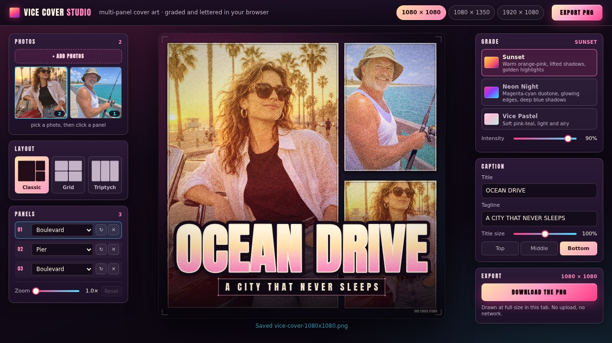

# VICE COVER STUDIO

[](https://make.fun/bounty/gta6-cover-art-01)
[](https://make.fun/bounty/gta6-cover-art-01)
[](https://make.fun/bounty/gta6-cover-art-01)

A multi-panel cover-art studio for the multi-panel cover-art era: load your own photos, pick a
layout and a grade, type a title, and download a finished poster as a PNG — all in the browser, with
the photos never leaving your machine.

An entry in the [make.fun](https://make.fun) bounty
[`gta6-cover-art-01` — Make GTA 6 Cover Art](https://make.fun/bounty/gta6-cover-art-01).



## What it does

- **Three layouts** — *Classic* (hero left, two stacked right), *Grid* (two by two) and
  *Triptych* (three tall panels). Every layout is drawn from fractional rectangles, so it scales
  cleanly to any post size.
- **Any photo** — `+ ADD PHOTOS`, drag files onto the window, or use the two bundled sample photos.
  Photo pixels are read locally into `` elements from blob URLs; there is no upload and no
  network request of any kind.
- **Crop and position per panel** — click a panel to select it, drag inside it to pan the photo,
  use the wheel (or the *Zoom* slider) to zoom in up to 4×, and *Reset* to re-centre. One photo can
  fill several panels, each with its own crop, or every panel can take a different photo.
- **Three colour grades** — *Sunset* (warm orange-pink, lifted shadows), *Neon Night* (magenta-cyan
  duotone, glowing edges) and *Vice Pastel* (soft pink-teal), each with an *Intensity* slider that
  also blends back to the untouched photo at 0%.
- **Bold caption lettering** — a fitted, tracked Anton title with an outline, a neon tagline and
  poster frame marks. The title can sit at the top, middle or bottom, scale from 50% to 150%, and be
  edited in place: click the caption on the cover, or type in the sidebar fields.
- **Three post sizes** — 1080 × 1080, 1080 × 1350 and 1920 × 1080, chosen in the header.
- **PNG export** — *EXPORT PNG* redraws the cover at full post size through the same `drawCover()`
  the preview uses, so the file you download is exactly the picture you were looking at
  (`vice-cover-1080x1080.png`, and so on).

Everything under `app/` is plain static files — no build step, no bundler, no framework, no
dependency to install. The only font is Anton, shipped in `app/fonts/` under the SIL Open Font
License (`app/fonts/OFL.txt`). The art is the app's own: no game logo, wordmark, artwork or font is
used anywhere.

## Run it

```bash
node serve.ts
```

Then open <http://localhost:8080>. `serve.ts` is a small static file server over Node's standard
library that serves `app/`; `--port 8099` moves it if 8080 is taken. Opening `app/index.html`
directly from disk works too, since nothing is fetched over the network.

Node 22 or newer. Nothing to install.

## Use it

1. **Pick a size** in the header: 1080 × 1080, 1080 × 1350 or 1920 × 1080.
2. **Load photos.** Click `+ ADD PHOTOS` and choose one or several images, or drop them anywhere on
   the window. Two sample photos (a boulevard at golden hour, a pier) are already in the tray.
3. **Pick a layout** on the left. The panel list below it shows what each panel holds.
4. **Fill a panel.** Click a thumbnail in the tray, then click the panel you want it in — or drag the
   photo inside a panel to pan it and scroll to zoom. The *Zoom* slider and *Reset* button under the
   panel list do the same thing precisely; `✕` empties a panel.
5. **Grade it.** Choose *Sunset*, *Neon Night* or *Vice Pastel* on the right and set *Intensity*.
6. **Letter it.** Type a title and tagline, drag *Title size*, and choose *Top*, *Middle* or
   *Bottom*. You can also click the caption on the cover itself and edit it there.
7. **Export.** Press `EXPORT PNG` (header or right rail) and the PNG downloads at full post size.

## The repository

| Path | What it is |
| --- | --- |
| `app/` | the whole app: `index.html`, `style.css`, `src/render.js` (layouts, grades, panel painting, lettering, `drawCover()`), `src/editor.js` (state, controls, pointer handling, export), `fonts/`, `samples/` |
| `screenshots/` | the entry's screenshots, the first (`1-cover.jpg`) being the cover the app exported |
| `main.ts` | hands the entry in: copies `app/` and `screenshots/` to the output directory and writes `dossier.json` with `buildDossier` from `vendor/makefun-app.ts` |
| `serve.ts` | the local static server above |
| `vendor/makefun-app.ts` | the kit's dossier library, unchanged |

To build the submission bundle locally:

```bash
mkdir -p out
MAKEFUN_OUTPUT_DIR=out node main.ts
```

That writes `out/app`, `out/screenshots` and `out/dossier.json`; two runs write identical bytes.

## License

MIT — see [LICENSE](LICENSE). The bundled Anton font is under the SIL Open Font License 1.1
(`app/fonts/OFL.txt`).
